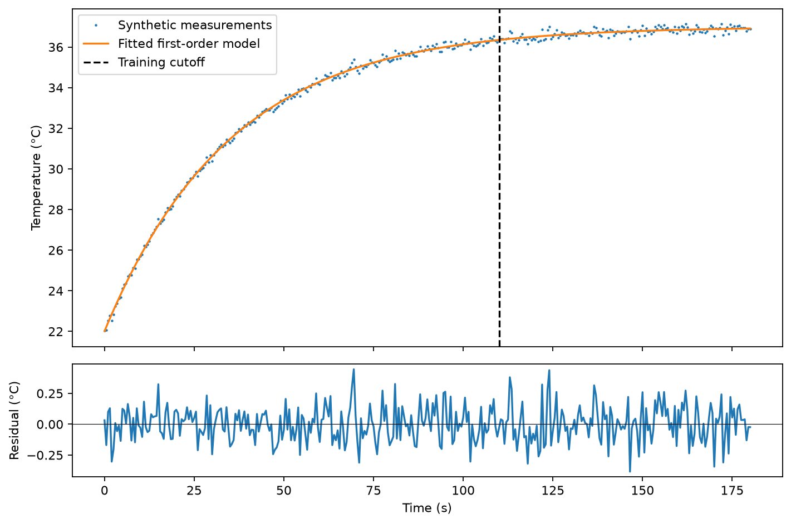

# Thermal response identification — OptiIA Consulting

Estimate a first-order thermal step response and predict settling time.

An executable project example using generated data. Images and graphs below are generated by the included code.



## Run

Python 3.12 recommended:
```bash
python -m pip install -r requirements.txt
python -m unittest -v test_analysis
python analysis.py --seed 42 --out results
```

The script writes plots, a data export and JSON metrics to `results/`. The committed `metrics.json` and `preview.png` correspond to seed 42. Import the functions in `analysis.py` to process your own compatible arrays.

## Method

Fit T(t) = T0 + deltaT (1-exp(-t/tau)) with bounded nonlinear least squares. Estimate baseline, steady-state temperature rise and time constant. Compute the model-based 95% settling time as -tau log(0.05), and check predictions on later held-out measurements.

## Assumptions and limitations

Positive heating step at known t=0; constant ambient temperature and a single time constant. No cooling control, PID tuning or device safety decisions. Real thermal systems may contain multiple poles, delays and changing ambient conditions. The fit is an empirical first-order model.

Synthetic results establish reproducibility of this example, not performance on real instruments. No proprietary source code, data or photographs are included.

## Validation

Four tests exercise exact reference cases, independent data or noise realizations, and input validation. See `test_analysis.py` for thresholds and checks.

## Related activities

Scientific computing, instrumentation data analysis, image processing and Python automation.

[More project examples](https://github.com/yaghi-ali) · [OptiIA Consulting](https://www.optiia-consulting.fr) · contact@optiia-consulting.fr
